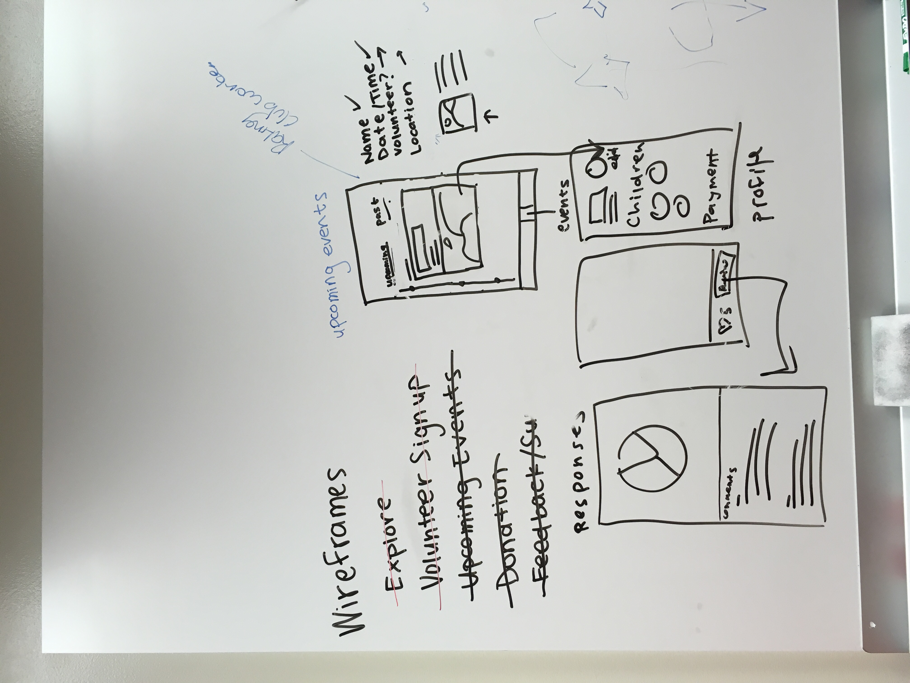
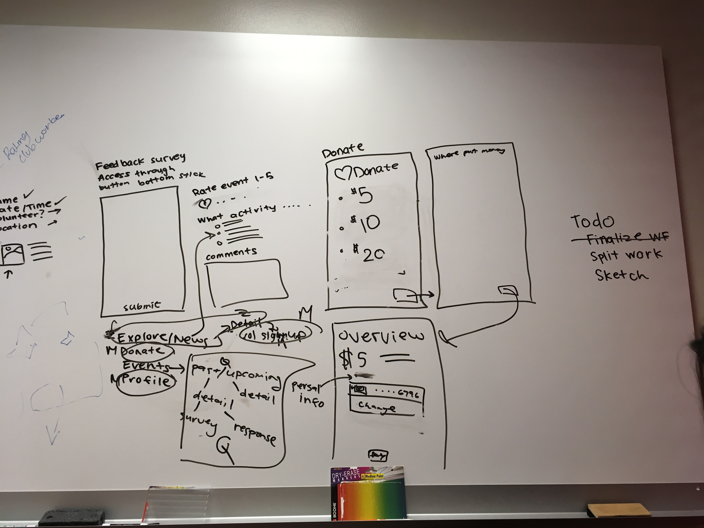
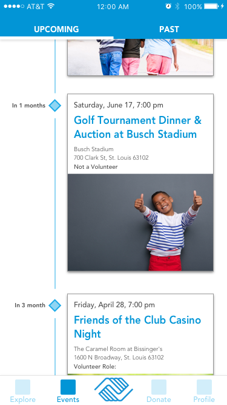
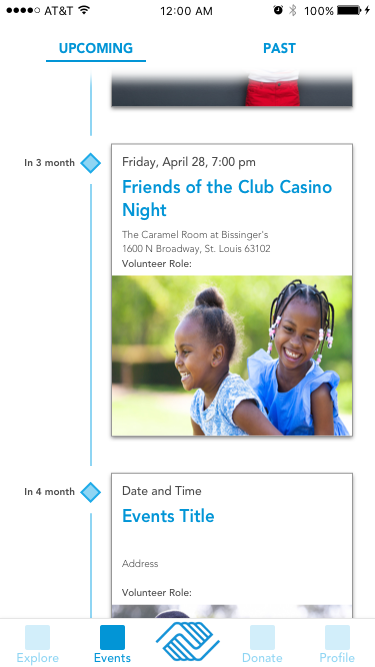
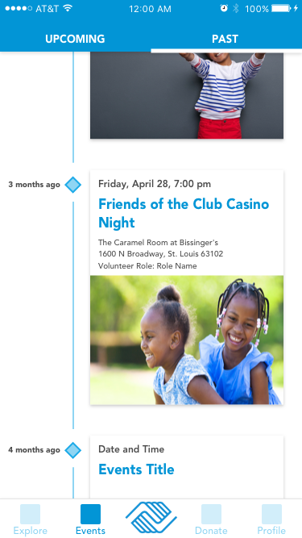
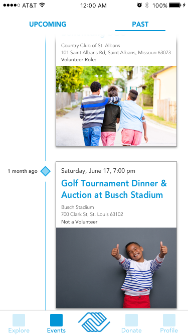
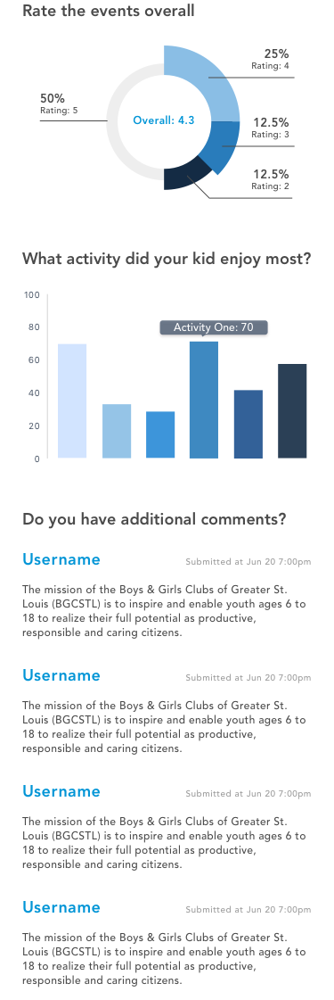
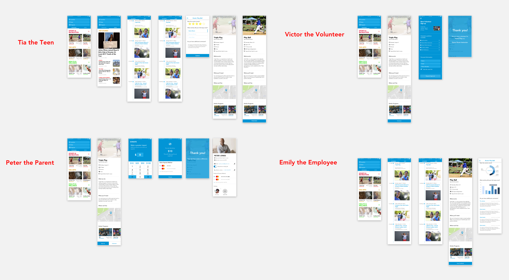

---
# basic info
layout: post
title: BGC Mobile App
date: 2017-07-27 -0600
# page info
type: Project
group: Internship
categories: [UX Design]
tags: [Sketch]
# project info
role: UX Designer
# content info
excerpt: A prototype app for an innovation challenge during my Mastercard internship
excerpt_zh: Mastercard 实习期间，为创新挑战赛做的 App 原型
---

This is a project done in my [internship](<>) at Mastercard. This project is to design and build a prototype for an iOS app for [Boys & Girls Clubs of Greater St. Louis](https://www.bgcstl.org/){:target="\_blank"}. We won first prize.

I was a user experience designer with two other interns. We started with the brainstorming of functionalities we wanted to provide for different types of users: teenagers, parents, volunteers, and club staff. For each group, we came up with a story. Following the flows, we narrowed down the scope to some core functionalities, including exploring events, signing up, browsing past and future events, making donations and writing feedback.

We shared mobile apps whose design we thought highly of, and we referred to some of them. For example, we liked the elegant design of the list view of the journey's history and the detail page in Airbnb. We loved the way Apple News uses bold fonts and bright colors to emphasize headings. We kept learning.

I designed the upcoming/past event pages, each with two versions, and created the feedback form.

Event pages:

| Version 1                                            | Version 2                                            |
| ---------------------------------------------------- | ---------------------------------------------------- |
|  |  |
|  |  |

Feedback form:

We combined all the wireframes to create a mockup:

-   Tia, the teenager, gets notification to review past events like "Triple Play," and signs up to volunteer "Play Ball."
-   Peter, the parent, donates to the event "Triple Play" and reviews his profile from which he can see the payment profile and his child, Tia.
-   Victor, the volunteer, signs up as a volunteer.
-   Emily views submitted feedback for "Play Ball," including aggregated data and individual comments.

