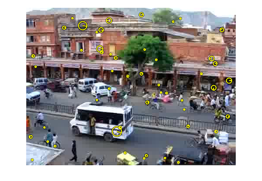
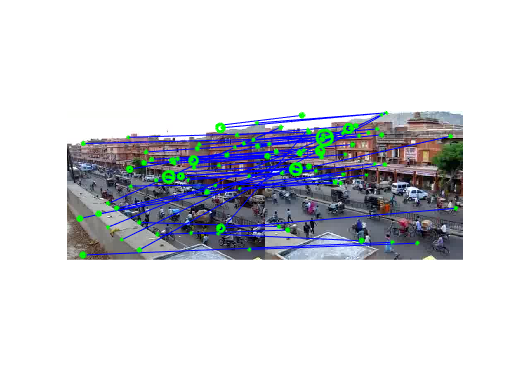
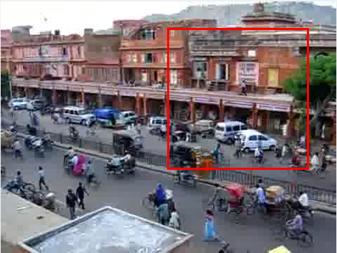
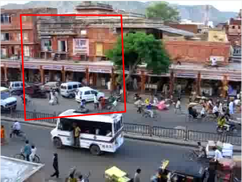
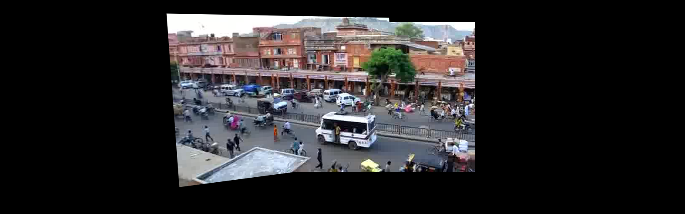
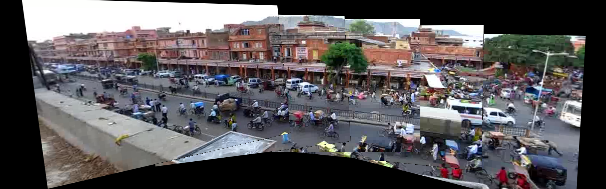
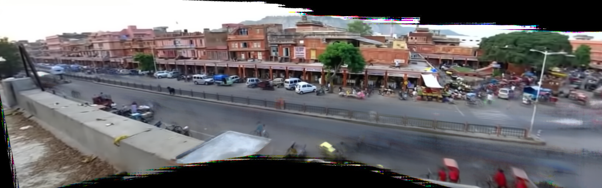

---
# basic info
layout: post
title: CS445 Project 5 Video Stitching and Processing
date: 2017-11-13 -0600
# page info
type: Project
categories: [Computational Photography]
tags: [Matlab]
exclude: true
# project info
role: Developer
# content info
excerpt: Applying transformations to videos
---

## Stitch two key frames

Take two images (frames `270` and `450`) as examples.

To stitch two overlapping video frames, first identify keypoints in both images, and match those keypoints.

| Key Points                                            | Key Points Matched                                    |
| ----------------------------------------------------- | ----------------------------------------------------- |
|  |  |

Then, compute the homography, a projective transformation, and project one frame to another by `maketform` and `imtransform`. For example, after the transformation, the red square on the left should match the red square on the right.

| Square in Frame `270`                                       | Square in Frame `450`                                       |
| ----------------------------------------------------------- | ----------------------------------------------------------- |
|  |  |

For simplicity, just replace zero pixels in one image with pixels from another image, without a better blending function.

## Panorama using five key frames

Use the same techniques on reference frames `90`, `270`, `450`, `630`, `810`, to project them onto frame `450`. In particular, to map a frame far from frame `450`, like `90`, first project it to a nearer frame `270`, to minimize the error.

## Map the video to the reference plane

Use the same techniques for all 900 frames, and use 5 reference frames as intermediate reference. Use `imageFolder2mpeg.m` to output a movie.

<iframe width="640" height="360" src="https://www.youtube.com/embed/_bmfMOpP0dI" frameborder="0" gesture="media" allowfullscreen></iframe>

I have tried to compute the homography between every pair of consecutive frames, but the result is not as good as this one.

## Create background panorama

To remove moving objects from the video and create a background panorama, first detect all background pixels in each frame by finding the median value pixel. Use the median pixel value for each pixel of the panorama.

In order to find the median ignoring black pixels, changing all zeros into `NaN`, using the MATLAB function `nanmedian` and changing them back to zeros gives the desired result. I use three channels separately to avoid finding medians for matrices with too many dimensions, but the trade-off is that there are unexpected colors near the border.

## Create background movie

Apply the reversed transformation in Part 3 on the background panorama to obtain a movie like the original one, but with background only.

<iframe width="640" height="360" src="https://www.youtube.com/embed/k5eeljkfVH0" frameborder="0" gesture="media" allowfullscreen></iframe>

## Create foreground movie

Foreground pixels are those that differ from background ones. Use the same technique in Parts 4 and 5 to obtain a foreground movie.

<iframe width="640" height="360" src="https://www.youtube.com/embed/1LwZCyQBfq4" frameborder="0" gesture="media" allowfullscreen></iframe>

## Generate a wide video

Basically the same as Part 5, but with a wider width.

<iframe width="640" height="360" src="https://www.youtube.com/embed/IxgJ8bWvx3M" frameborder="0" gesture="media" allowfullscreen></iframe>
