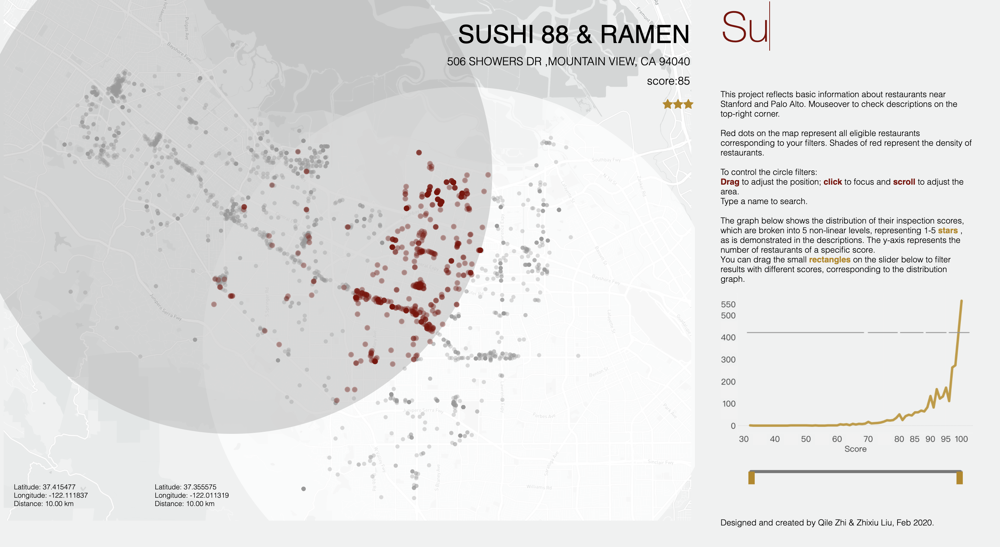

---
# basic info
layout: post
title: CS448B Project 3 Creating Interactive Visualization Software
date: 2020-02-10 -0800
# page info
type: Project
categories: [Data Visualization]
tags: [HTML5, CSS, JavaScript, D3]
exclude: true
# project info
role: Designer, Web Developer
demo: https://www.youtube.com/watch?v=yJbabUIZvoI
website: https://sumerinlan.github.io/stanford-cs448b-a3/
# content info
excerpt: An interactive tool to explore restaurant inspection scores in the South SF Bay Area
---

Our application built with D3 displays restaurant data points on a map of South San Francisco Bay Area. It allows users to (1) filter restaurants by distance to pivot points specified, and (2) type and filter restaurants.

