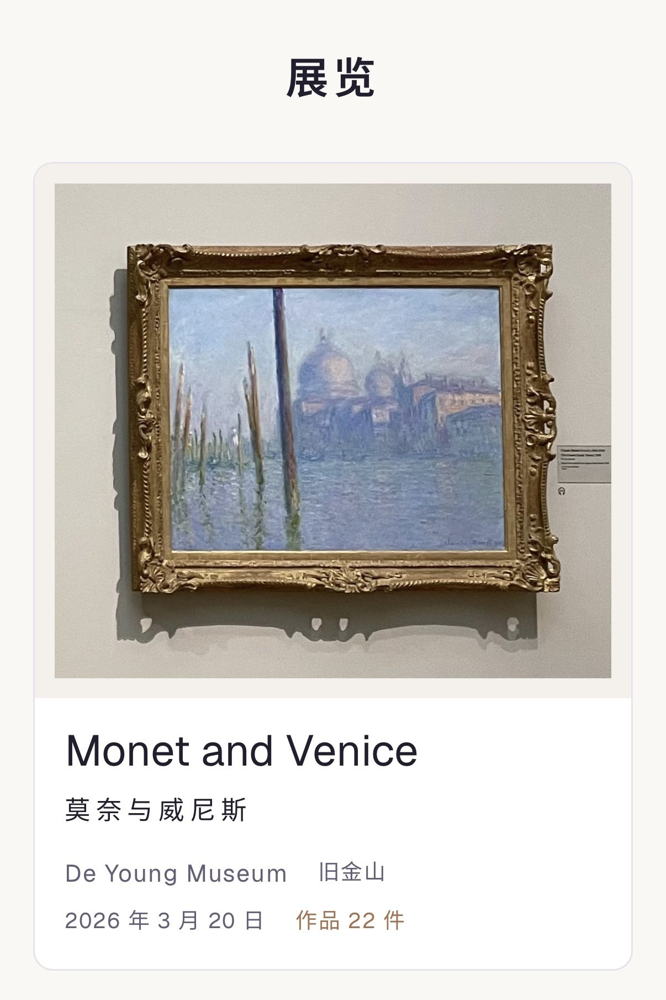
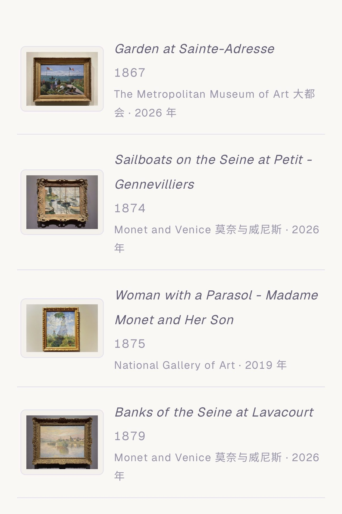
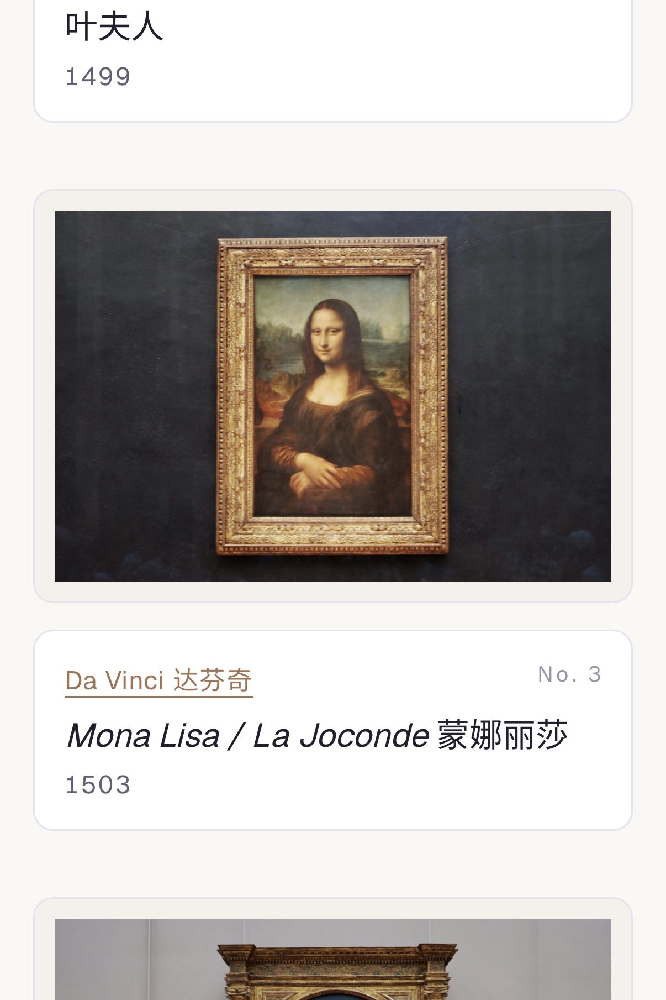

---
# basic info
layout: post
title: My Gallery
date: 2026-10-16 -0700
# page info
type: Project
group: Personal
categories: [Web Development]
tags: [Notion, Muse]
# project info
role: Creator
# content info
excerpt: A read-optimized online gallery for seven years of my museum visits
excerpt_zh: 记录我七年博物馆参观的在线画廊，为浏览而设计
cover: /assets/posts/2026-10-16-my-gallery/cover.jpg
---

In 2020 I planned a trip to Paris. To prepare, I started a Western art history podcast. The pandemic canceled the trip, but I listened to the end. After that I kept learning through books and exhibitions. The more I saw, the more interested I became.

In 2026 I organized what I had learned in Notion. I started with three databases: movements, artists and artworks.

That year I saw *Manet & Morisot* and *Monet and Venice* in the Bay Area. I straightened the perspective in my photos, and I liked how they looked. I wanted a good place to look at them. So I added two more databases, for museums and exhibitions.

Then I noticed a problem. Notion is good for organizing, not for viewing.

- **Organizing happens once. Viewing happens many times.** Each time I wanted a different view.
- **The fields I needed for organizing were noise when I looked at a painting.**
- **Sharing was awkward.** To show someone a painting, I had to open Notion myself and find the page for them.

So I kept the data in Notion and built a separate gallery for viewing.

## Building It

I built it with Muse. Muse wrote all of the code. I decided what the gallery should do.

- **Data:** Muse reads the five databases through its Notion connector. It flattens their relations into one table. I copy nothing by hand.
- **Images:** iPhone photos are resized to 1600px on the long edge, at JPEG quality 82. They load fast on a phone.
- **Steps:** I started with one exhibition and five paintings, then made changes. Next came two exhibitions and ten paintings, with more artists and museums, and another round of changes. Then the full set.
- **Navigation:** this changed the most. A museum page holds its permanent collection. Only special exhibitions have their own page. An artist page lists their works across museums.
- **Links:** related works link to each other, also across museums.

    <figure><figcaption>A special exhibition has its own page.</figcaption></figure>
    <figure><figcaption>An artist's works, across museums and exhibitions.</figcaption></figure>

## Details

- **Two views:** each work has a wall-label view and a thumbnail view.
- **Titles:** bilingual, English first.
- **Photos:** every photo has its perspective straightened.
- **Labels:** typeset like the ones in the museum.

    <figure><figcaption>A work in the wall-label view.</figcaption></figure>
    <figure><figcaption>Works in the thumbnail view.</figcaption></figure>

These details are small. Together they make the gallery mine.

## What's Inside

119 works, 33 artists, 14 exhibitions and 30 museums, from 2019 to 2026. They include the Musée d'Orsay, the Louvre and the Orangerie in Paris, two exhibitions in the Bay Area, and the National Gallery of Art in Washington, D.C. I took every photo.

## P.S.

I planned to share the gallery publicly. The image review rejected Ingres's *Grande Odalisque* and Manet's *Olympia*. So the gallery stays private, and this page shows screenshots. I am fine with that. I built it for myself to look back on.
