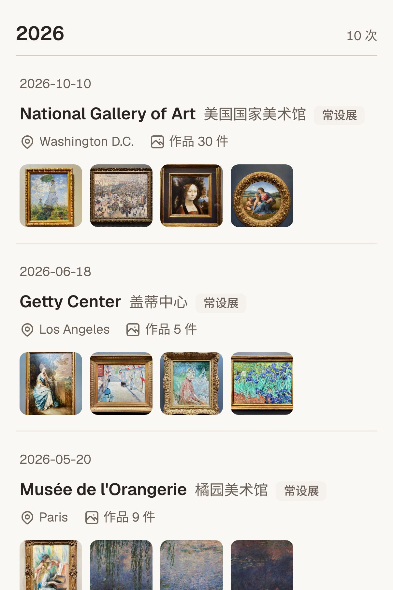
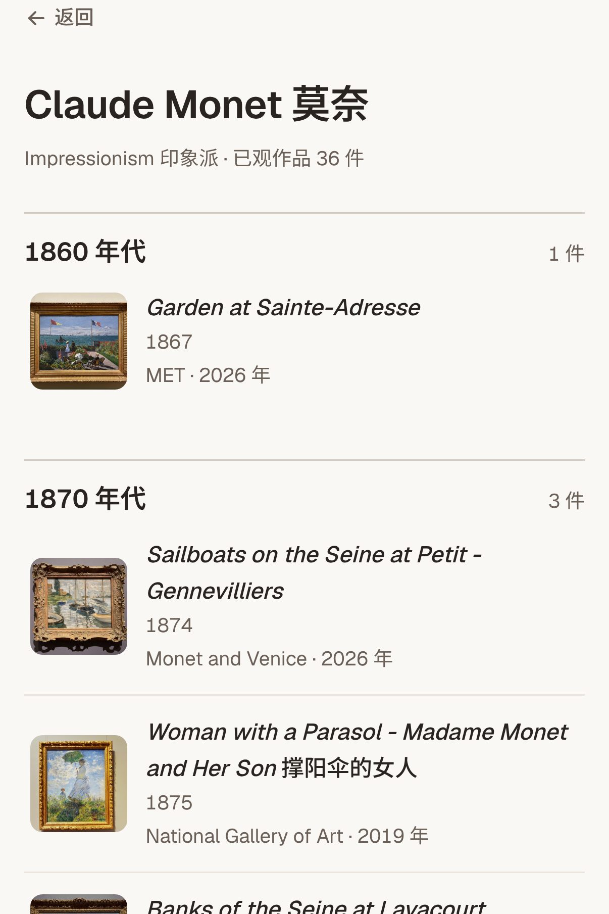
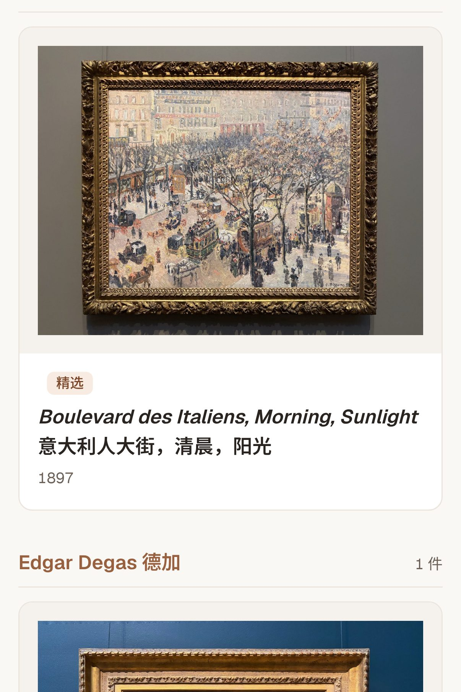
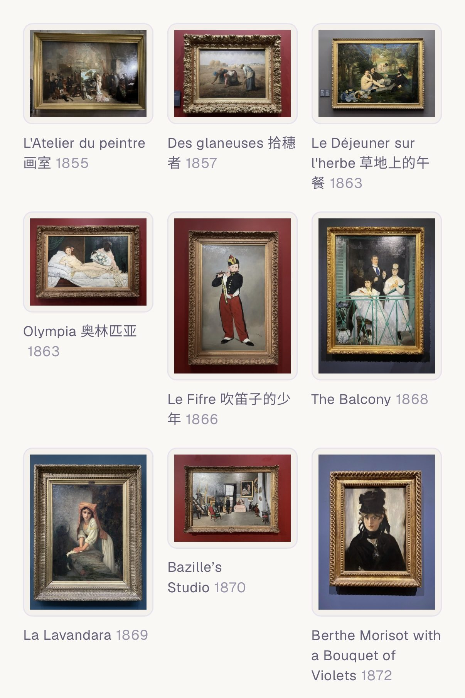

---
# basic info
layout: post
title: My Gallery
date: 2026-10-16 -0700
# page info
type: Project
group: Personal
categories: [Web Development]
tags: [Notion, Muse, Claude, Vercel]
# project info
role: Creator
# content info
excerpt: A read-optimized online gallery for seven years of my museum visits
excerpt_zh: 记录我七年博物馆参观的在线画廊，为浏览而设计
cover: /assets/posts/2026-10-16-my-gallery/cover.jpg
---

In 2020 I planned a trip to Paris. To prepare, I started a Western art history podcast. The pandemic canceled the trip, but I listened to the end. After that I kept learning through books and exhibitions. The more I saw, the more interested I became.

In 2026 I organized what I had learned in Notion. I started with three databases: movements, artists and artworks.

That year I saw *Manet & Morisot* and *Monet and Venice* in the Bay Area. I straightened the perspective in my photos, and I liked how they looked. I wanted a good place to look at them. So I added two more databases, for museums and exhibitions.

Then I noticed a problem. Notion is good for organizing, not for viewing.

- **Organizing happens once. Viewing happens many times.** Each time I wanted a different view.
- **The fields I needed for organizing were noise when I looked at a painting.**
- **Sharing was awkward.** To show someone a painting, I had to open Notion myself and find the page for them.

So I kept the data in Notion and built a separate gallery for viewing: [museum-journal-ochre.vercel.app](https://museum-journal-ochre.vercel.app). The interface is in Chinese, and titles show English first.

## Building It with Muse

In October I built the first version with Muse. Muse wrote all of the code. I decided what the gallery should do.

- **Data:** Muse reads the five databases through its Notion connector. It flattens their relations into the data the site uses. I copy nothing by hand.
- **Steps:** I started with one exhibition and five paintings, then made changes. Next came two exhibitions and ten paintings, with more artists and museums, and another round of changes. Then the full set.
- **Navigation:** this changed the most. A museum page holds its permanent collection. Only special exhibitions have their own page. An artist page lists their works across museums.

    <figure><figcaption>Every visit, by year. A special exhibition opens its own page; a permanent collection opens the museum page.</figcaption></figure>
    <figure><figcaption>Monet's works, each with where I saw it.</figcaption></figure>

## Going Public

I wanted to share the gallery. On Muse's platform, the image review rejected Ingres's *Grande Odalisque* and Manet's *Olympia*, so the gallery had to stay private there.

In November I moved the code to its own repository and deployed it on Vercel. There the gallery is public. My notes on each work stay behind a login.

## Two Agents

Then Claude joined. It rebuilt the look with my personal design system and added tests.

Later it found two bugs that no one had noticed. Related works had never appeared, because the site read a different field name from the one in the data. And every work was marked as a favorite, because the sync script treated a "no" value as true. The pages looked fine, and nothing reported an error.

So I split the work between the two agents, with one set of rules for both:

- **Muse** syncs the data from Notion and makes small changes I ask for.
- **Claude** owns the site code and reviews Muse's commits. When it finds a mistake, it fixes it and adds a test that catches that kind of mistake.
- **Both** run every check before they commit, and commit only when all pass. A change to a field name updates the sync script, the code that reads the field and the tests in one commit.

I don't count on either agent being careful. I count on the checks.

## Details

- **Labels:** typeset like the ones in the museum. On a wide screen, the label sits beside the painting.
- **Titles:** bilingual, English first.
- **Photos:** every photo has its perspective straightened.
- **Two views:** a museum page has a detail view with labels and a thumbnail view.

    <figure><figcaption>A work with its label.</figcaption></figure>
    <figure><figcaption>The Musée d'Orsay in the thumbnail view.</figcaption></figure>

These details are small. Together they make the gallery mine.

## What's Inside

My museum visits from 2019 to 2026, in Paris, New York, the Bay Area, Washington, D.C. and Los Angeles. I took every photo.
